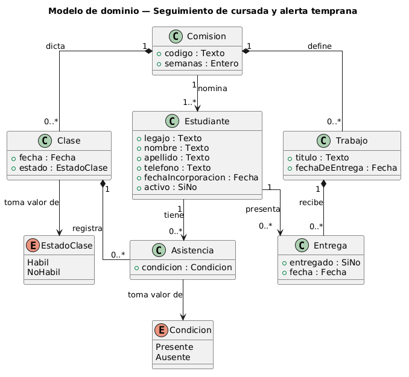
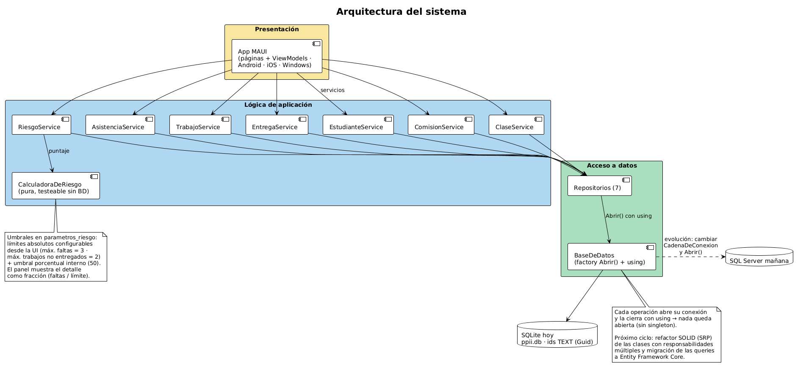
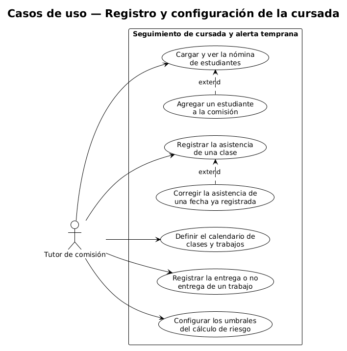
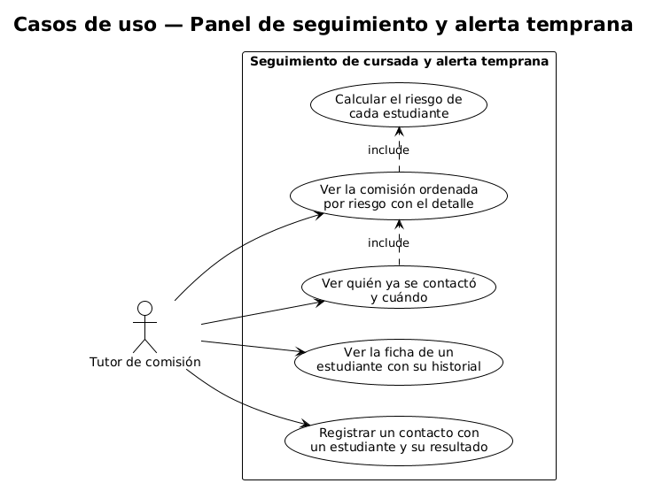

	# Grupo 3

## Integrantes

- Elias Villegas
- Yesica Quezada
- Isaias Romero
- Ibañez Mario

## Descripción

Seguimiento de cursada y alerta temprana.
Un panel para que quien sigue una comisión sepa a qué estudiantes contactar esta semana, antes de que abandonen.

## Modelo de dominio

El sistema está modelado sobre cinco entidades centrales: **comisiones** (con la cantidad de **semanas** del cuatrimestre), **estudiantes** (con baja lógica mediante `activo`), **clases**, **trabajos** y sus registros de **asistencia** y **entrega**.

Decisiones de modelado que responden a reglas de negocio:

- `Clase.estado` (`EstadoClase` = `Habil` | `NoHabil`): las clases feriadas o suspendidas **no reciben asistencia y se excluyen del cálculo de riesgo** (H2 + H6), de modo que el denominador de inasistencias siempre cuenta solo clases hábiles.
- `Estudiante.activo` (`SiNo`): la baja es **lógica**, no se borran filas; los listados y búsquedas filtran por `activo` para conservar el historial.
- `Asistencia.condicion` (`Presente` | `Ausente`) y `Entrega.entregado` (`SiNo`) son las **dos señales** que alimentan el indicador de riesgo (H6).

## Modelo de arquitectura

El sistema a producir se organiza en tres capas:

- **Presentación**: App MAUI (páginas + ViewModels) para Android, iOS y Windows.
- **Lógica de aplicación**: siete servicios (`Estudiante`, `Comision`, `Clase`, `Asistencia`, `Trabajo`, `Entrega`, `Riesgo`) y `CalculadoraDeRiesgo`, una clase pura testeable sin base de datos.
- **Acceso a datos**: siete repositorios sobre `BaseDeDatos.Abrir()` (factory; cada operación abre y cierra su conexión con `using`, sin singleton) → SQLite (`ppii.db`, ids `TEXT`/Guid).

Los umbrales del indicador de riesgo viven en la tabla `parametros_riesgo`: **límites absolutos configurables desde la UI** (máx. faltas = 3 · máx. trabajos no entregados = 2) y un **umbral porcentual interno** (50). El panel muestra el detalle como fracción —por ejemplo `2/3` faltas— junto con el motivo del riesgo.

Evolución prevista: la migración a SQL Server se concentra en `CadenaDeConexion`/`Abrir()`; el próximo ciclo agrega el **refactor SOLID (SRP)** de las clases con responsabilidades múltiples y la **migración de las queries a Entity Framework Core**.

## Casos de uso

Dos vistas del alcance según el momento del ciclo: primero cómo se cargan y configuran los datos, después cómo se consume la decisión.

### Registro y configuración de la cursada

Cubre la entrada de datos: nómina (H1, con la carga de estudiantes como extensión), calendario (H2), asistencia (H3, con la corrección de fechas ya registradas como extensión H4), entregas (H5) y umbrales del riesgo (H7).

### Panel de seguimiento y alerta temprana

Cubre la salida de decisión: el panel ordenado por riesgo con el detalle que justifica cada valor (H8, que **incluye** el cálculo H6), la ficha del estudiante con su historial (H9), el registro de contactos (H10) y la vista de quién ya fue contactado y cuándo (H11, que **incluye** la vista del panel).

